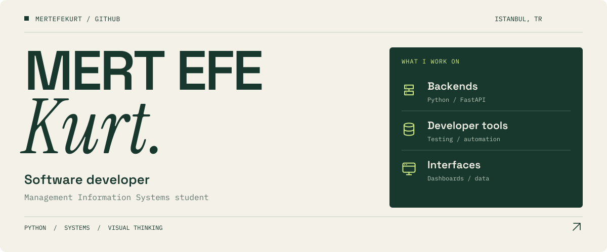
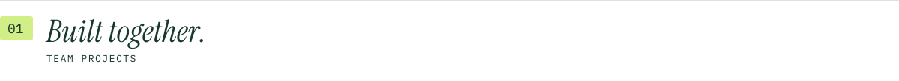
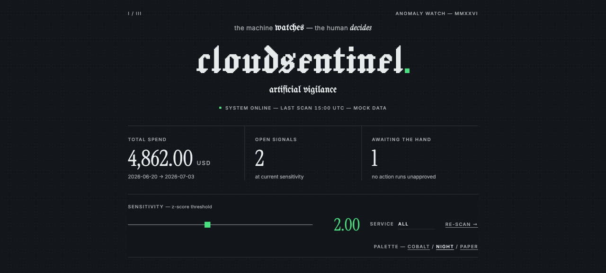
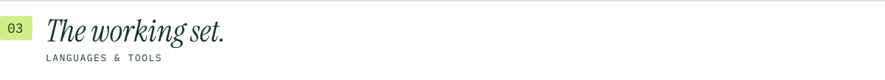
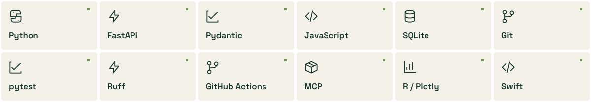

<picture>
  <source media="(max-width: 640px)" srcset="assets/identity/hero-mobile.svg" />
  
</picture>

 

I’m Mert, a software developer and Management Information Systems student in Istanbul. Most of my work starts in Python: APIs, command-line tools, and tests for the parts of a system that are easy to get wrong.

I also work on the interface side. In team projects, that has meant building a cloud-cost dashboard and connecting an AI assistant to a database with read-only access. A few examples are below, with links to the code and my contributions.

  
  
  
  

 

<picture>
  <source media="(max-width: 640px) and (prefers-color-scheme: dark)" srcset="assets/identity/team-mobile-dark.svg" />
  <source media="(max-width: 640px)" srcset="assets/identity/team-mobile-light.svg" />
  <source media="(prefers-color-scheme: dark)" srcset="assets/identity/team-dark.svg" />
  
</picture>

### [CloudSentinel ↗](https://github.com/muratcan-ates/cloudsentinel)

Cloud-cost monitoring with a dashboard for reviewing signals and approving actions. Built with **YZTA Bootcamp · AI Track · Group 60**.

My contributions cover the cost-summary API, interactive dashboard, theme switching, and CI fixes. The dashboard work includes service filtering, ledger sorting, and a fix for the API documentation’s content security policy.

Night-mode dashboard from my merged contribution. The preview uses mock data.

[Dashboard & themes, PR #4](https://github.com/muratcan-ates/cloudsentinel/pull/4) · [Cost API, PR #1](https://github.com/muratcan-ates/cloudsentinel/pull/1) · [CI & documentation, PR #5](https://github.com/muratcan-ates/cloudsentinel/pull/5)

### [KOBİ Ops AI ↗](https://github.com/emirselengil/YZTA-AI-Hackathon-Team215)

An operations assistant built for the **YZTA AI Hackathon · Team 215**.

I worked on the Gemini backend and MCP integration: SQLite tools for inspecting tables and running read-only queries, quota handling with retries and fallback responses, and tests for the database access rules.

[Backend contribution, merged PR #1 →](https://github.com/emirselengil/YZTA-AI-Hackathon-Team215/pull/1)

 

<picture>
  <source media="(max-width: 640px) and (prefers-color-scheme: dark)" srcset="assets/identity/tools-mobile-dark.svg" />
  <source media="(max-width: 640px)" srcset="assets/identity/tools-mobile-light.svg" />
  <source media="(prefers-color-scheme: dark)" srcset="assets/identity/tools-dark.svg" />
  
</picture>

| Project | What it does |
| :--- | :--- |
| **[eval-delta](https://github.com/mertefekurt/eval-delta)** | Compares paired evaluation runs and flags regressions, including changes hidden within metadata slices. Produces confidence intervals and reports for CI. |
| **[agent-trace-lint](https://github.com/mertefekurt/agent-trace-lint)** | Checks recorded agent tool calls for protocol errors, exposed secrets, loops, and latency problems. Runs offline. |
| **[mcp-probe](https://github.com/mertefekurt/mcp-probe)** | Tests stdio MCP servers against contract scenarios: schemas, tool calls, assertions, and latency. Exports JSON and JUnit reports. |
| **[llm-replay-proxy](https://github.com/mertefekurt/llm-replay-proxy)** | Records and replays non-streaming, OpenAI-compatible API calls with local JSON cassettes for repeatable integration tests. |
| **[PixelMorph](https://github.com/mertefekurt/pixelmorph)** | A PyQt image-processing app for sorting pixels vertically, horizontally, or by brightness. |
| **[Chocolate Ratings Dashboard](https://github.com/mertefekurt/MIS029-Chocolate-Dashboard)** | An R flexdashboard exploring chocolate ratings with ggplot2, Plotly, and interactive tables. [Open dashboard ↗](https://mertefekurt.github.io/MIS029-Chocolate-Dashboard/) |

 

<picture>
  <source media="(max-width: 640px) and (prefers-color-scheme: dark)" srcset="assets/identity/stack-mobile-dark.svg" />
  <source media="(max-width: 640px)" srcset="assets/identity/stack-mobile-light.svg" />
  <source media="(prefers-color-scheme: dark)" srcset="assets/identity/stack-dark.svg" />
  
</picture>

<picture>
  <source media="(max-width: 640px)" srcset="assets/identity/stack-mobile.svg" />
  
</picture>

 

For project, internship, or collaboration conversations, you can reach me by email.

<a href="mailto:mertk.mek@gmail.com">
  <picture>
    <source media="(max-width: 640px)" srcset="assets/identity/contact-mobile.svg" />
    
  </picture>
</a>
