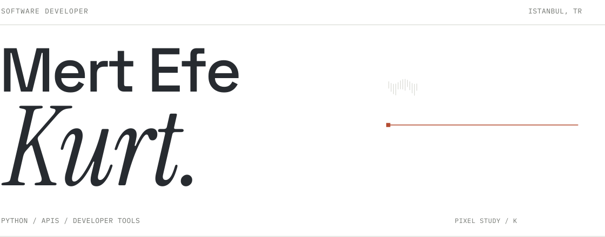

<picture>
  <source media="(max-width: 640px) and (prefers-color-scheme: dark)" srcset="assets/editorial/cover-mobile-dark.svg" />
  <source media="(max-width: 640px)" srcset="assets/editorial/cover-mobile-light.svg" />
  <source media="(prefers-color-scheme: dark)" srcset="assets/editorial/cover-dark.svg" />
  
</picture>

 

I’m a developer and Management Information Systems student in Istanbul. I build Python backends and testing tools, with the occasional experiment in image processing.

  <a href="https://mertefekurt.me"><picture><source media="(prefers-color-scheme: dark)" srcset="assets/minimal/website-dark.svg" /></picture> Website</a>
  &nbsp; · &nbsp;
  <a href="https://www.linkedin.com/in/mertefekurt/"><picture><source media="(prefers-color-scheme: dark)" srcset="assets/minimal/linkedin-dark.svg" /></picture> LinkedIn</a>
  &nbsp; · &nbsp;
  <a href="mailto:mertk.mek@gmail.com"><picture><source media="(prefers-color-scheme: dark)" srcset="assets/minimal/mail-dark.svg" /></picture> Email</a>

 

### Selected work

**[CloudSentinel ↗](https://github.com/muratcan-ates/cloudsentinel)** 
Cloud-cost monitoring, built with YZTA Bootcamp Group 60. I contributed the cost API, interactive dashboard, and theme switching. [My contribution](https://github.com/muratcan-ates/cloudsentinel/pull/4).

**[KOBİ Ops AI ↗](https://github.com/emirselengil/YZTA-AI-Hackathon-Team215)** 
An operations assistant built with YZTA Hackathon Team 215. I worked on the Gemini backend, read-only SQLite tools, and quota handling. [My contribution](https://github.com/emirselengil/YZTA-AI-Hackathon-Team215/pull/1).

**[mcp-probe ↗](https://github.com/mertefekurt/mcp-probe)** 
Contract tests for MCP servers: tool calls, schemas, assertions, and latency. JSON and JUnit reports for CI.

**[PixelMorph ↗](https://github.com/mertefekurt/pixelmorph)** 
A small PyQt app that turns images into pixel-sorting experiments.

  
More from my workbench

- [eval-delta](https://github.com/mertefekurt/eval-delta) — compare evaluation runs and catch regressions.
- [agent-trace-lint](https://github.com/mertefekurt/agent-trace-lint) — inspect agent tool-call traces offline.
- [llm-replay-proxy](https://github.com/mertefekurt/llm-replay-proxy) — record and replay API calls for repeatable tests.
- [Chocolate Ratings Dashboard](https://mertefekurt.github.io/MIS029-Chocolate-Dashboard/) — explore chocolate reviews with R and Plotly.

 

Python &nbsp; / &nbsp; FastAPI &nbsp; / &nbsp; SQLite &nbsp; / &nbsp; pytest &nbsp; / &nbsp; Git &nbsp; / &nbsp; MCP

---

For projects, internships, or a conversation: [mertk.mek@gmail.com](mailto:mertk.mek@gmail.com)

Cover study — *K, in lines.* Inspired by [PixelMorph](https://github.com/mertefekurt/pixelmorph).
